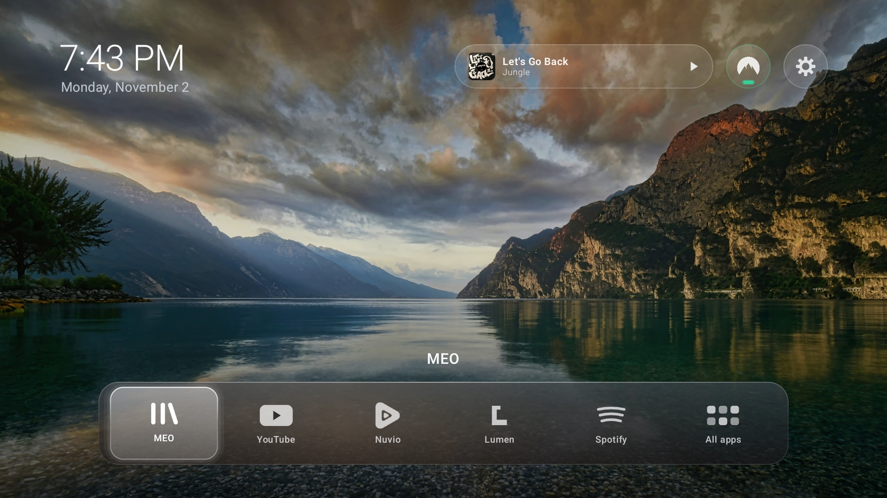
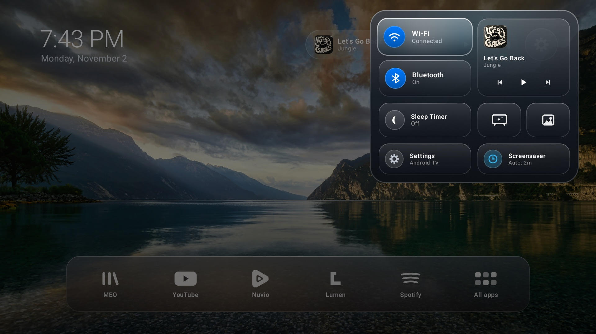
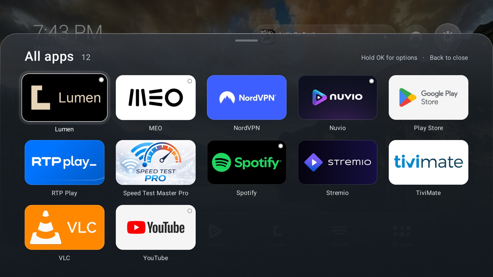
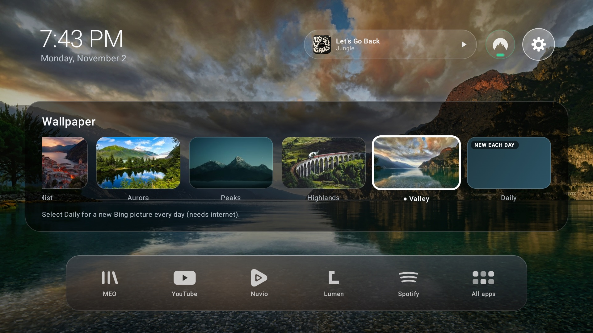
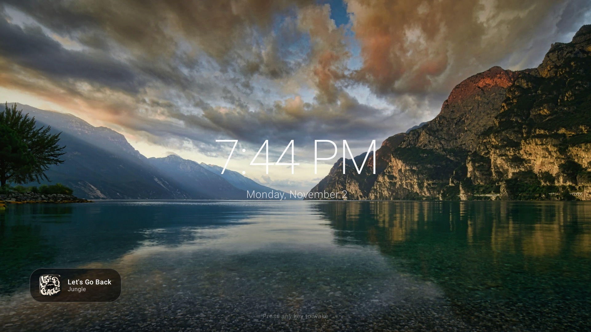

# Lumen Home

A minimal, fast home screen for Android TV and Google TV, with a frosted-glass look inspired by tvOS.

Lumen Home shows the apps you choose plus a clock and the date. It has no recommendation rows, ads or tracking. The background is an animated aurora gradient drawn in code (no bitmap), or one of the bundled wallpapers, and the app tiles are translucent glass with a soft glow on focus.



| Control Center | All apps |
| --- | --- |
|  |  |
| **Wallpapers** | **Ambient screensaver** |
|  |  |

## Features

- **Glass home screen**: frosted app tiles with rim highlights, a focus glow and smooth D-pad navigation built with Compose for TV.
- **Control Center**: press the gear in the top bar to open a glass side panel with:
  - **Network**: live Wi-Fi (with SSID) or Ethernet status, with a shortcut to network settings.
  - **Bluetooth**: connected device and audio status, with a shortcut to Bluetooth settings.
  - **VPN**: connection indicator, the name of the active VPN app and a quick picker.
  - **Sleep timer**: 15, 30, 45, 60 or 90 minutes; pauses media and puts the TV in standby.
  - **Screensaver**: start ambient mode now or set the idle timeout (2 min, 5 min, 10 min or off).
  - **Wallpapers**: five bundled landscapes or the Bing image of the day.
  - **Remote color keys**: map the red, green, yellow and blue buttons to launch any app from anywhere.
  - **Android settings**: one click to the system settings.
- **Now Playing**: appears in the top bar while audio is playing, with animated equalizer bars, the track title and the artist. Press OK to play or pause; long-press to open the music app.
- **Ambient screensaver**: slow Ken Burns pan and zoom over the wallpaper, a thin clock and date, the wallpaper caption and Now Playing. The clock moves slightly every minute to protect OLED screens from burn-in. Press any button to return.
- **App management**: long-press an app to add it to or remove it from the dock, move it, open App info or uninstall it. Everything else lives in the All apps panel.

## Install

### Download

Grab the latest APK from the [Releases](../../releases) page. Release builds are signed with a debug key and are meant for sideloading.

### Enable debugging on the TV

Go to **Settings → System → About**, select **Build** several times until developer options unlock, then turn on **USB debugging** (or **Network debugging**) in developer options.

### Install and set as Home

```sh
adb connect DEVICE_IP:5555
adb install -r lumen-home.apk
adb shell cmd package compile -m speed-profile -f com.goncalocosta.lumen.home
adb shell cmd package set-home-activity com.goncalocosta.lumen.home/.MainActivity
```

The `compile` step applies the bundled baseline profile so the app starts faster. It is optional.

### Optional: full Now Playing metadata

To show track details from third-party apps (Spotify, YouTube Music, etc.), grant notification listener access:

```sh
adb shell cmd notification allow_listener com.goncalocosta.lumen.home/.MediaNotificationListener
```

## Build from source

Requirements: [Android Studio](https://developer.android.com/studio) (or JDK 17+ and the Android SDK), plus `adb` from `platform-tools`.

```sh
./gradlew assembleRelease
adb install -r app/build/outputs/apk/release/app-release.apk
```

The release build is minified with R8 and includes baseline profiles. Run the unit tests with `./gradlew test`.

## Privacy

The only network access is the optional **Daily** wallpaper. When selected, the app downloads Bing's image of the day once a day (about 300 KB), caches it in app storage and falls back to the chosen bundled wallpaper when offline. This is the only reason the app requests the `INTERNET` permission.

## Restore the stock launcher

```sh
adb shell cmd package set-home-activity com.google.android.tvlauncher/.MainActivity
```

If you disabled it, run `adb shell pm enable com.google.android.tvlauncher` first.

## Device tips

- [MEOBox 4K speed & debloat guide](docs/meobox-debloat.md): disable operator telemetry, the stock launcher and pre-installed apps on the MEOBox 4K.

## Credits

Bundled wallpapers are from [Unsplash](https://unsplash.com), used under the [Unsplash License](https://unsplash.com/license). Photos by:

- [Anders Jildén](https://unsplash.com/photos/cYrMQA7a3Wc)
- [Aurora Wu](https://unsplash.com/photos/o_WT6J29u_o)
- [Daniel Leone](https://unsplash.com/photos/v7daTKlZzaw)
- [Jack Anstey](https://unsplash.com/photos/XVoyX7l9ocY)
- [Martin Bullimore](https://unsplash.com/photos/A0ON0vdb0gc)

Daily wallpapers come from Bing and remain the property of their respective owners.

Not affiliated with Apple or Google. Android TV and Google TV are trademarks of Google LLC.

## License

[MIT](LICENSE). The bundled photographs are covered by the Unsplash License, not MIT.
